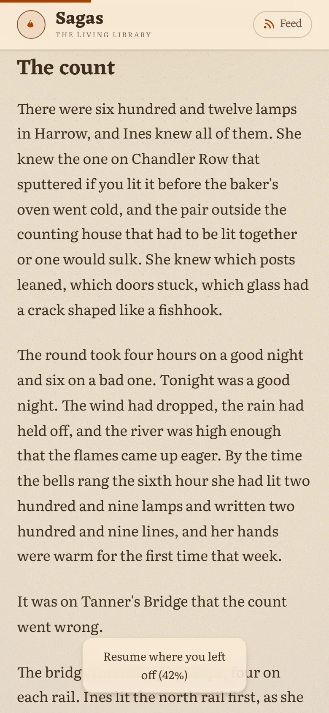
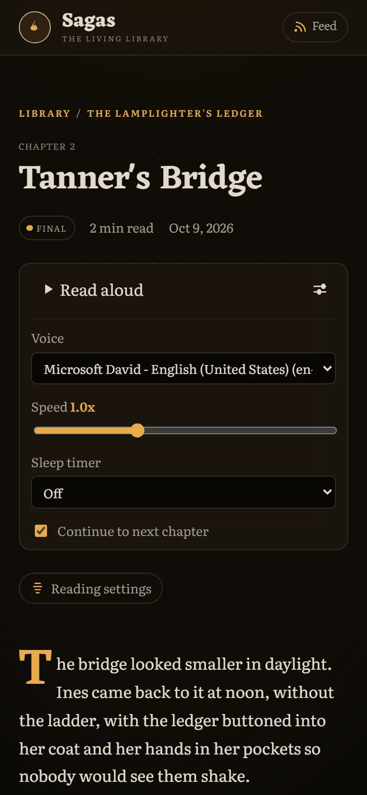
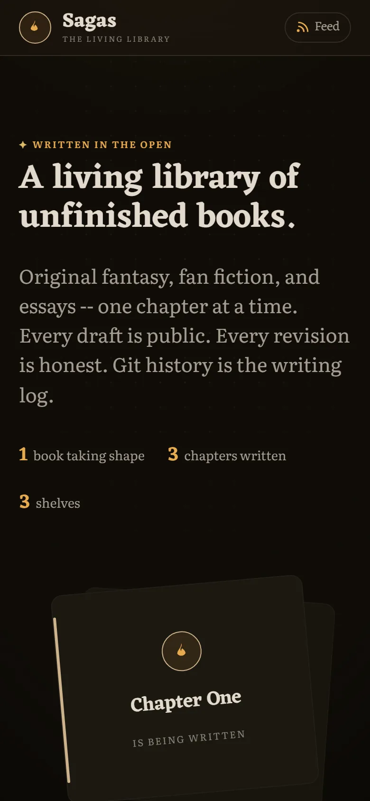
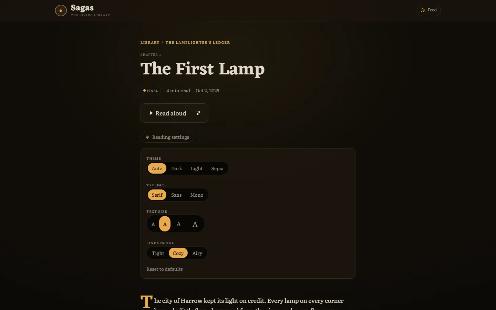
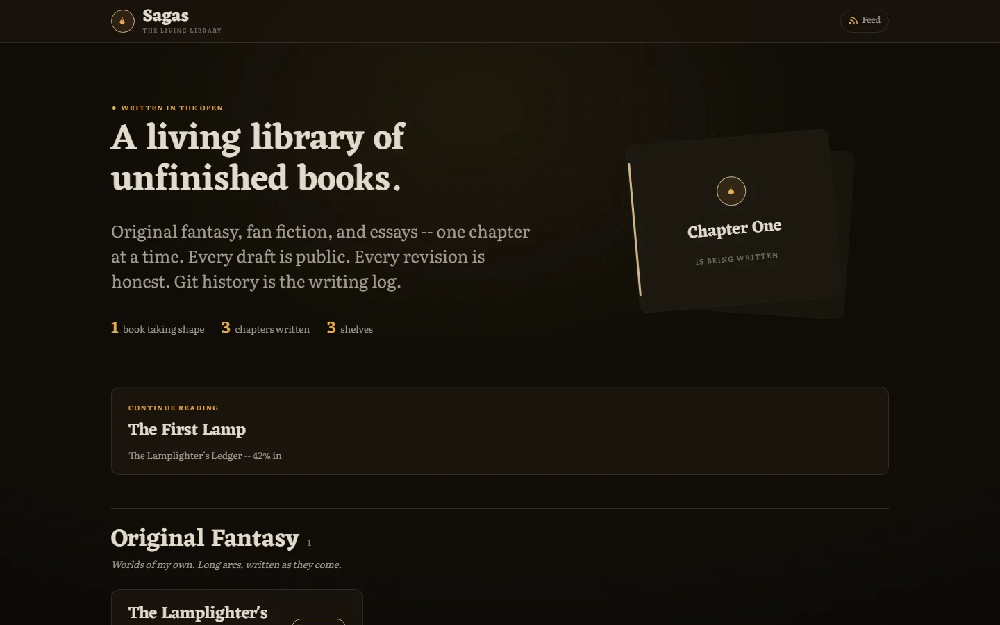
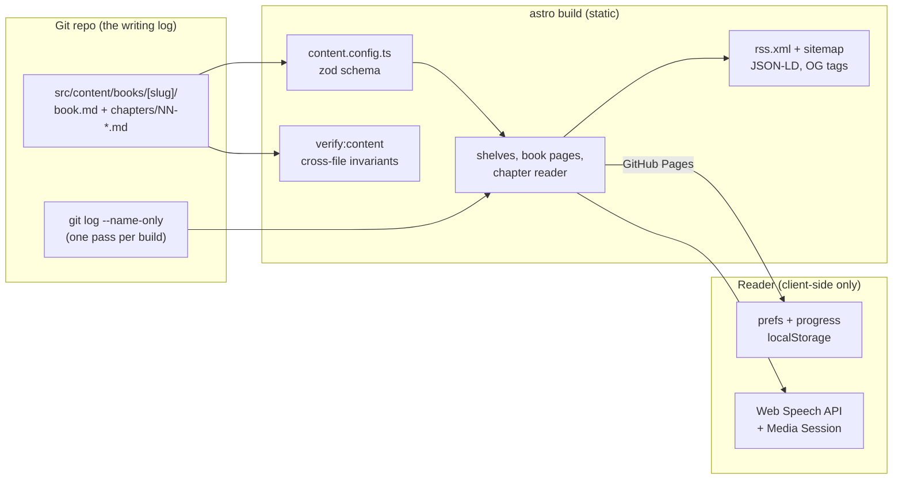

# sagas

[](https://github.com/Sagargupta16/sagas/actions/workflows/ci.yml)
[](https://github.com/Sagargupta16/sagas/actions/workflows/deploy.yml)
[](https://sagargupta.online/sagas/)
[](https://astro.build)

A living library of unfinished books.

Original fantasy, fan fiction, and essays on how I see the world -- written in
the open, one chapter at a time. Live at
[sagargupta.online/sagas](https://sagargupta.online/sagas).

The shelves are built and open; the first books are being written. Every book
starts as an idea and gets written in public. Drafts are drafts; git history is
the writing log.

## See it

<table>
  <tr>
    <td width="33%"></td>
    <td width="33%"></td>
    <td width="33%"></td>
  </tr>
</table>





The real shelves are still empty, so these show the demo book from
[tests/fixtures/books/](tests/fixtures/books/reader-demo/). It only exists in
demo and test builds; the live site never includes it. `pnpm screenshots`
regenerates every image from a running demo build.

## Try the reader locally

```
pnpm install
pnpm dev:demo        # http://localhost:4321/sagas/ with the demo book
```

`dev:demo`, `build:demo` and `test:e2e:demo` set `SAGAS_FIXTURES=1`, which
loads the three-chapter demo book next to the real library. Scroll a chapter,
reload, open the reading settings, press the arrow keys, try read-aloud: all of
it runs in the browser with nothing to sign up for.

## The shelves

- **Original Fantasy** -- worlds of my own, long arcs, written as they come.
- **Fan Fiction** -- stories set in universes I love. Free, non-commercial,
  always.
- **Essays** -- my perspective on popular topics, one essay at a time.

## The reader

The site is a static Astro 7 build, but the chapter reader is a small
client-side reading platform (no backend, no accounts, everything in
localStorage):

- reader preferences: theme (auto/dark/light/sepia), typeface, text size,
  line spacing -- applied before first paint
- reading progress: per-chapter position with a resume offer and a
  "continue reading" card on the homepage
- keyboard (arrows / h,l) and swipe navigation between chapters
- read-aloud via the browser's speech synthesis, with voice/speed/sleep-timer
  controls and lock-screen media keys
- per-chapter writing history straight from git: first drafted, last revised,
  revision count

Motion honors `prefers-reduced-motion` everywhere.

## How it works



- **Content is the database.** Each book is a folder of Markdown; the Astro
  content collection schema rejects bad frontmatter at build time, and
  `scripts/verify-content.mjs` catches what a per-file schema cannot (orphan
  chapters, duplicate `order`, filename/order mismatch, future `publishedOn`).
- **Git is the writing history.** One `git log` pass per build maps every
  chapter to its first-drafted date, last revision and revision count, so the
  public "how this was written" timeline costs one child process, not one per
  chapter.
- **No backend, no accounts.** Theme, typeface, text size, spacing and
  per-chapter progress live in `localStorage`; preferences apply in an inline
  head script before first paint so there is no theme flash.
- **Read-aloud without a TTS service.** The browser's speech synthesis drives
  narration, with voice, speed, sleep timer and lock-screen controls via the
  Media Session API.
- **The dash rule reaches the prose.** Markdown runs through satteri with
  smart punctuation off, so `--` in a chapter stays `--`.

## Stack

Astro 7 static site with content collections. Books are folders of Markdown
under [src/content/books/](src/content/books/); one `book.md` plus one file
per chapter (see the README there for the exact contract).

```
pnpm install
pnpm dev             # local dev at :4321/sagas
pnpm dev:demo        # same, plus the demo book
pnpm build           # static build to dist/
pnpm build:demo      # static build with the demo book
pnpm check           # types + content schema
pnpm verify:content  # cross-file content invariants
pnpm format:check    # prettier
pnpm test:e2e        # Playwright tests against the built site
pnpm test:e2e:demo   # same, against a build:demo site (what CI runs)
pnpm screenshots     # README images, from a running demo build
```

CI runs all of those on every pull request: it builds the real site, checks
the demo book is not in it, then rebuilds with the demo book and runs the
browser suite. Pushes to `main` deploy the real build to GitHub Pages.

## Quality

Lighthouse 13.5.0, mobile, against `pnpm preview` of a `pnpm build:demo`
site, measured 2026-10-18:

| Page          | Performance | Accessibility | Best practices | SEO | LCP   | Transfer |
| ------------- | ----------- | ------------- | -------------- | --- | ----- | -------- |
| Home          | 99          | 100           | 100            | 100 | 1.7 s | 88 KiB   |
| Chapter (1/3) | 100         | 100           | 100            | 100 | 1.7 s | 93 KiB   |

Total blocking time was 0 ms on both. There are no JavaScript files to
download: the reader's scripts are inlined, and the transfer is mostly the two
self-hosted variable fonts.

The Playwright suite has 78 tests: 26 each at desktop, a Pixel 7, and a 320px
viewport. They cover reading progress (saved on scroll, kept across a reload,
resume offer), arrow-key navigation, theme persistence, the continue-reading
card, RSS draft filtering, slash-terminated canonicals and sitemap entries,
and the `--` dash rule in built prose.

## Adding a chapter

1. Drop `NN-title.md` into `src/content/books/<book>/chapters/`.
2. Frontmatter: `title`, `order`, `status` (`draft | revising | final`), and
   `publishedOn` once it should appear in the
   [RSS feed](https://sagargupta.online/sagas/rss.xml).
3. Push. CI validates, main deploys.

## License

Code is MIT. The writing itself (everything under `src/content/`) is
[CC BY-NC-ND 4.0](https://creativecommons.org/licenses/by-nc-nd/4.0/). Fan
fiction is transformative fan work: free, non-commercial, and unaffiliated
with the rights holders of the universes it borrows. See [LICENSE](LICENSE).
